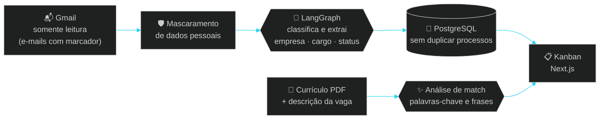
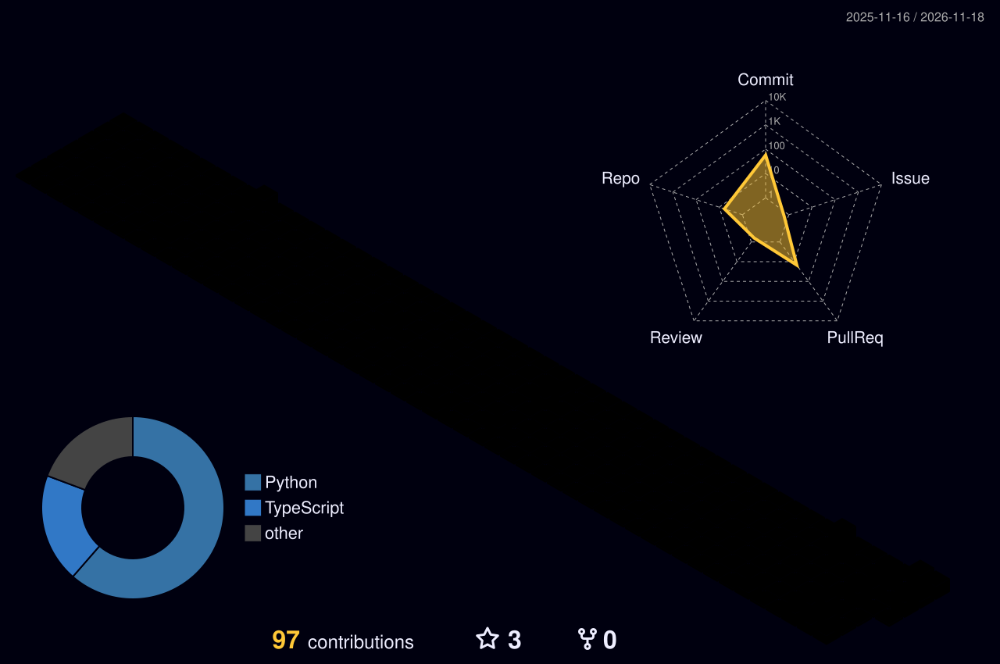

<!-- ===================== HEADER ===================== -->
<div align="center">


<a href="https://github.com/RianLMA-dev">
  
</a>

<br/><br/>


&nbsp;&nbsp;

&nbsp;&nbsp;

&nbsp;&nbsp;


<br/><br/>

<a href="https://github.com/RianLMA-dev"></a>
<a href="https://www.linkedin.com/in/rian-lucas-7a8ab1323/"></a>
<a href="mailto:rianlucasalb@gmail.com"></a>

</div>

<br/>

<!-- ===================== SOBRE ===================== -->
##  Sobre mim

```python
class RianLucas:
    role    = "Estudante de Ciência da Computação @ UFC"
    focus   = ["IA aplicada", "Automação", "Backend em Python", "Fullstack"]
    stack   = ["Python", "FastAPI", "LangGraph", "n8n", "PostgreSQL", "Docker", "React/Next.js"]
    mindset = "Tecnologia boa é a que simplifica o dia a dia e gera resultado real."

    def mission(self) -> str:
        return "Transformar problemas reais em soluções com impacto real."
```

O que mais me move são desafios com problemas reais e soluções que tragam impacto de verdade. Sou movido pela curiosidade em **Inteligência Artificial** e **automação**: uso IA para criar soluções para microsserviços e pequenos empreendedores e desenvolvo automações com **n8n** para eliminar tarefas repetitivas.

Um exemplo é um fluxo que capta e organiza automaticamente e-mails de vagas de estágio, poupando tempo e garantindo que nenhuma oportunidade passe batido.

Comecei montando sistemas para pequenos negócios com ferramentas no-code e hoje faço o mesmo tipo de coisa com mais controle: automações em n8n e backends em Python, com banco de dados, testes e Docker.

<br/>

<!-- ===================== STACK ===================== -->
##  Stack

<details open>
<summary><b>🧠 Inteligência Artificial</b></summary>
<br/>
<p align="center">
  
  
  
  
  
</p>
</details>

<details open>
<summary><b>⚡ Automação e Integrações</b></summary>
<br/>
<p align="center">
  
  
  
  
  
  
  
</p>
</details>

<details open>
<summary><b>💻 Linguagens</b></summary>
<br/>
<p align="center">
  
  
  
  
  
  
</p>
</details>

<details open>
<summary><b>🌐 Web e Frameworks</b></summary>
<br/>
<p align="center">
  
  
  
  
  
  
  
</p>
</details>

<details open>
<summary><b>🗄️ Banco de Dados</b></summary>
<br/>
<p align="center">
  
  
  
</p>
</details>

<details open>
<summary><b>🛠️ Ferramentas e Métodos</b></summary>
<br/>
<p align="center">
  
  
  
  
  
  
  
</p>
</details>

<br/>

<!-- ===================== PROJETOS ===================== -->
##  Projetos em destaque

<div align="center">
  <a href="https://github.com/RianLMA-dev/ResuMe">
    
  </a>
  <a href="https://github.com/RianLMA-dev/monitor-precos-n8n">
    
  </a>
  <a href="https://github.com/RianLMA-dev/url-shortener">
    
  </a>
</div>

<br/>

### 🤖 [ResuMe](https://github.com/RianLMA-dev/ResuMe) · Assistente de candidaturas com agentes de IA

Acompanha processos seletivos automaticamente e ajuda a melhorar o currículo para cada vaga.



- **Privacidade primeiro:** e-mail, telefone, CPF e links são trocados por marcadores antes de o texto ir para a IA.
- **Sem alucinação:** ao comparar currículo e vaga, a regra é nunca inventar experiência.
- **Sem duplicatas:** o mesmo processo seletivo não é registrado duas vezes no kanban.
- **Engenharia:** back-end em FastAPI com PostgreSQL, Docker Compose e testes em Pytest.

<p>
  
  
  
  
  
  
  
</p>

### 💸 [Monitor de Preços](https://github.com/RianLMA-dev/monitor-precos-n8n) · Automação em n8n

Lê produtos de uma planilha, confere o preço na página da loja, atualiza a planilha e **avisa no Discord** quando o preço chega ao valor definido. Lê o preço por **JSON-LD**, com seletor CSS como alternativa, e trata falhas sem parar o fluxo. O README conta o que funcionou e o que foi bloqueado.

<p>
  
  
  
</p>

### 🔗 [Encurtador de URLs](https://github.com/RianLMA-dev/url-shortener) · API REST

API em FastAPI com **alias personalizado**, redirecionamento **302** e **contagem de cliques**. Código em camadas (router, service e repository), PostgreSQL com Docker Compose e **21 testes em pytest**.

<p>
  
  
  
  
</p>

<br/>

<!-- ===================== EXPERIÊNCIA ===================== -->
##  O que tenho feito

| Período | O que fiz |
| :-- | :-- |
| **Mar/2026 → hoje**<br/>Freelancer | **Automação e IA para pequenos negócios.** Dashboards e fluxos sob medida para clínicas, pet shops e barbearias. Uso n8n com a Evolution API para confirmar consultas, mandar lembretes e responder dúvidas frequentes por WhatsApp com apoio de IA, e junto faturamento, agenda e retorno de clientes em um painel só. |
| **Mar → Set/2026**<br/>ProgeteQuest | **Front-end.** Telas de uma plataforma web em React e TypeScript, com layout responsivo, componentes reutilizáveis e integração com o back-end por API REST. |
| **UFC Russas**<br/>Clube do Improviso | **Plataforma fullstack.** Site informativo com React, Node.js e banco SQL, que o clube usa para divulgar atividades e eventos. |

<br/>

<!-- ===================== ALÉM DO CÓDIGO ===================== -->
##  Além do código

**🏅 Coordenação do setor de Esportes · Associação Atlética Indomável** *(ago/2024 → mar/2026)*
Liderei um time de **20 pessoas** e organizei **3 eventos esportivos**, com público médio de **150 pessoas** entre atletas e torcida. Dividi as responsabilidades entre a equipe, acompanhei prazos e logística de cada evento e gravei uma série de vídeo-aulas para os novos membros aprenderem as atividades do setor e como os eventos são organizados, o que facilitou a passagem de conhecimento para as próximas gestões.

**⏱️ Hackathon de 35 horas · ExpologHack** *(ago/2024)*
Em uma equipe de 5 pessoas, trabalhei em uma proposta para reduzir as emissões de carbono no setor logístico. Fiquei com a prototipação no Figma e com a organização das entregas em ciclos curtos. Ficamos entre as equipes de destaque, entre 19 participantes.

<br/>

<!-- ===================== STATS + 3D ===================== -->
##  GitHub em números

<div align="center">

<!-- Gráfico 3D de contribuições: gerado pelo workflow profile-3d.yml (veja as instruções) -->


<br/><br/>


</div>

<br/>

<!-- ===================== CONTATO ===================== -->
## 📡 Vamos conversar?

Se você tem um problema repetitivo para automatizar, uma ideia de produto com IA ou quer trocar uma ideia sobre backend, é só chamar.

<div align="center">

<a href="https://www.linkedin.com/in/rian-lucas-7a8ab1323/"></a>
<a href="mailto:rianlucasalb@gmail.com"></a>

<br/><br/>


</div>
